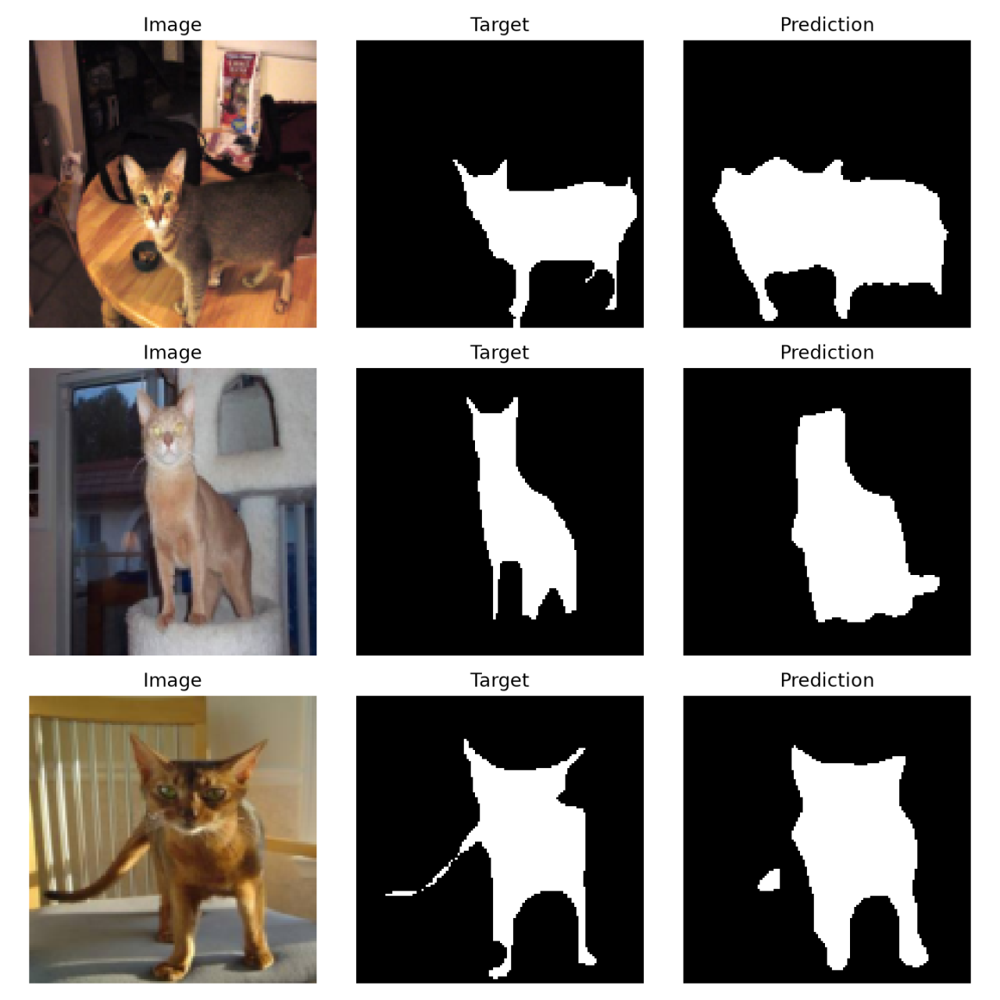

# U-Net on Oxford-IIIT Pet

A compact U-Net implementation for binary pet segmentation at 128×128. It uses the [Oxford-IIIT Pet trimap](https://www.robots.ox.ac.uk/~vgg/data/pets/): value 1 is the pet, value 2 is background, and ambiguous boundary pixels (value 3) are excluded from the loss and metrics. Images and masks are resized and flipped together; masks use nearest-neighbor interpolation.

This is a **small U-Net adaptation** for a pet dataset, not a numerical reproduction of the original biomedical imaging paper.

## Setup and run

```bash
python3 -m venv .venv
source .venv/bin/activate
python -m pip install -r requirements.txt pytest
python -m pytest -q
python train.py --loss combined --epochs 20 --out runs/combined
```

The first run downloads the dataset and annotations (about 800 MB). The official `trainval` split is divided into training and validation with a fixed seed. The official test split is evaluated after selecting the best validation IoU checkpoint. Each run saves `best.pt`, `history.csv`, `examples.png`, and `result.json`. The default device is MPS, CUDA, or CPU depending on availability.

## Loss comparison

```bash
python train.py --loss bce --epochs 20 --out runs/bce
python train.py --loss dice --epochs 20 --out runs/dice
python train.py --loss combined --epochs 20 --out runs/combined
```

Keep the seed, split, model, epoch count, and learning rate fixed. Compare **validation IoU** first. Do not choose a loss based on the test results.

| Loss | Best validation IoU | Test IoU | Notes on boundaries and failures |
| --- | --- | --- | --- |
| BCE | 86.90% | 87.07% | Predictions not visually inspected |
| Dice | 85.41% | 84.91% | Predictions not visually inspected |
| BCE + Dice | 87.48% | 87.52% | Thin parts missed; see examples below |

These results were reported from a Windows WSL run on an NVIDIA GeForce RTX 5060. Each run used seed 42, 20 epochs, batch size 4, image size 128, and the same training/validation split; only `--loss` changed. The combined loss had the highest validation IoU in this single-seed comparison: 0.58 percentage points above BCE and 2.07 points above Dice. Its test Dice score was 93.34%. The reported output files are saved for [BCE](results/bce_result.json), [Dice](results/dice_result.json), and [BCE + Dice](results/combined_result.json). Loss values across different loss functions are not directly comparable; select using validation IoU, and repeat with more seeds before drawing a general conclusion.

## Qualitative examples



In these three combined-loss test examples, the first cat's predicted silhouette is wider than the target and partly fills the gaps around its legs. The seated cat's ear tips and lower-leg details are smoothed away. In the third example, most of the thin tail is missed, and a small separate foreground patch appears to the left of the body. These are observations from three images, not a dataset-wide error analysis.

To learn the method, trace one image through the encoder and decoder in `model.py`; explain which feature maps are concatenated and why.

References: [Ronneberger et al., U-Net](https://arxiv.org/abs/1505.04597); [Torchvision dataset API](https://docs.pytorch.org/vision/main/generated/torchvision.datasets.OxfordIIITPet.html).
